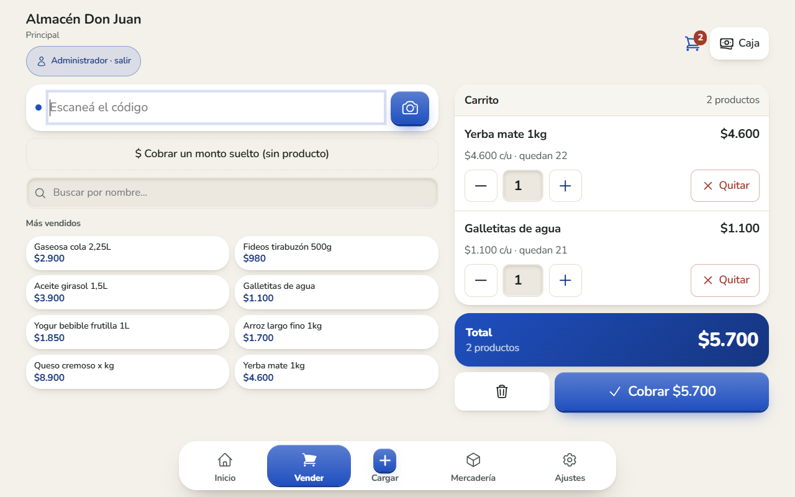
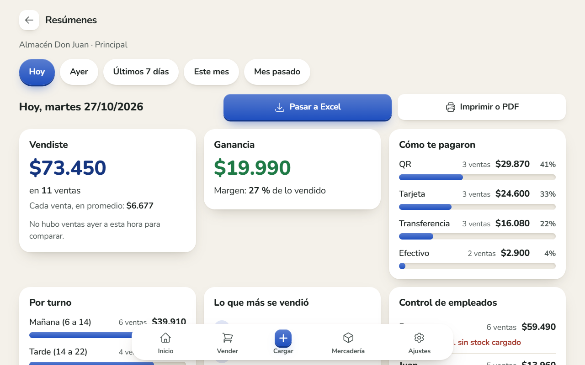
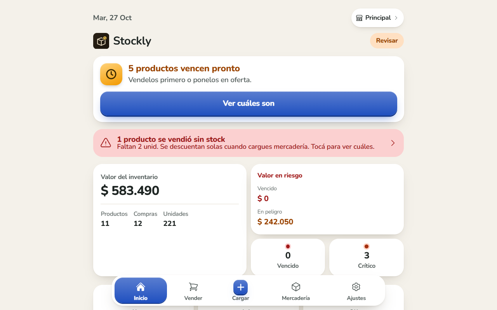
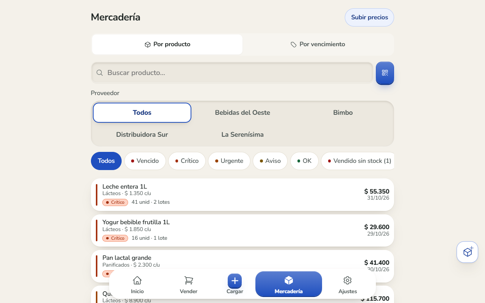
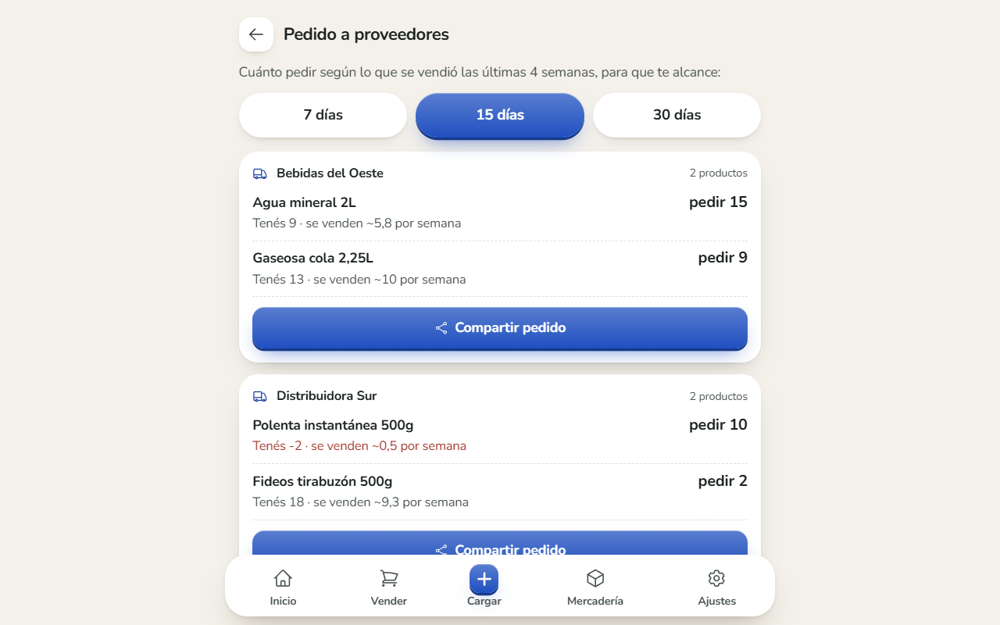
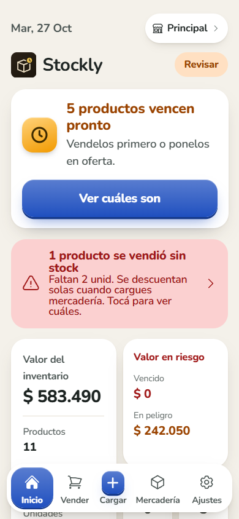

# Stockly — stock, vencimientos y caja para almacenes de barrio

[](https://github.com/Vloom02/Stockly/actions/workflows/ci.yml)
[](https://github.com/Vloom02/Stockly/actions/workflows/backend.yml)

App Android (tablet y celular) para comercios chicos atendidos por **gente mayor**: controla lo que vence,
vende con lector de códigos, lleva la caja por turno y le muestra al dueño cuánto vende y cuánto gana.
**Funciona sin internet** y sincroniza sola cuando vuelve la conexión.

Ionic React 8 · TypeScript · Capacitor 8 · Supabase (Postgres 17, RLS, RPC) · Vitest · GitHub Actions

| Vender (tablet acostada) | Resúmenes |
|---|---|
|  |  |

| Inicio | Mercadería | Pedido sugerido | Celular |
|---|---|---|---|
|  |  |  |  |

## Qué hace

- **Vencimientos**: cada compra es un lote con su fecha; alertas escalonadas (aviso → urgente → crítico → vencido),
  sugerencia de descuento para liquidar y avisos push diarios.
- **Punto de venta**: lector físico (USB o Bluetooth, en cualquier pantalla), cámara o búsqueda; cobro con vuelto,
  fiado, ofertas. Descuenta el stock **FEFO** (primero lo que vence antes) en el servidor.
- **Stock negativo a propósito**: si se vende algo que no se cargó, queda en negativo para que el dueño lo vea,
  y el próximo ingreso lo descuenta solo (-2 + 6 = 4).
- **Turnos con PIN**: el dueño usa su cuenta en el celular y en la tablet; cada empleado entra con su nombre y PIN
  y no ve precios, reportes ni ajustes del dueño. Todo queda a nombre de quien tenía el turno.
- **Resúmenes**: ventas, ganancia y margen (con el costo del día de cada venta), control de empleados (vendido sin
  stock y diferencias de caja), pérdidas; se pasa a **Excel con formato** o se imprime / guarda como PDF.
- **Pedido sugerido** por proveedor según lo vendido en las últimas 4 semanas, listo para mandar por WhatsApp.
- **Accesible para mayores**: letra grande ajustable, contraste alto, botones de 48 px o más, colores elegidos
  por investigación (azul cobalto; nada de verdes azulados claros), animaciones que se pueden apagar.

## Decisiones técnicas

- **Offline-first**: toda escritura va primero a IndexedDB y a una cola (`outbox`) que se sube en orden. Un error
  permanente va a cuarentena: **nunca se descarta** un cambio no confirmado.
- **Stock atómico en el servidor**: vender (`registrar_venta`) y ajustar (`ajustar_stock`) son RPC con lock por lote,
  idempotentes por id: un reintento de red no descuenta dos veces. Los ajustes viajan como *delta*, nunca como
  cantidad absoluta, para no pisar lo que vendió otro dispositivo al mismo tiempo.
- **Multi-comercio con Row Level Security**: cada comercio ve solo lo suyo a nivel de base de datos; escritura del
  catálogo solo para el dueño; historial de movimientos inmutable.
- **Un solo stock aunque no haya internet**: Mercadería resta al instante lo vendido que todavía no subió, y la cola
  y los lotes se releen en el mismo sync para no contar dos veces.
- **Rendimiento**: datos derivados memoizados con índices por producto (de O(productos × lotes) a O(n)), código por
  pantalla con `React.lazy`, Excel cargado solo al exportar, índices compuestos `(comercio_id, …)` en Postgres.

## Pruebas

```bash
npm test                          # 100+ pruebas de lógica (Vitest)
bash scripts/pruebas-backend.sh   # Supabase local nuevo + todas las migraciones + 32 pruebas del backend
```

Las del backend levantan un Supabase en Docker, aplican las migraciones en orden (`supabase/orden-migraciones.txt`)
y prueban RLS entre comercios, ventas concurrentes, stock negativo, costo y el panel de soporte. Las dos corren en
GitHub Actions en cada cambio.

## Correrlo

```bash
npm install
cp .env.example .env    # VITE_SUPABASE_URL y VITE_SUPABASE_ANON_KEY
npm run dev
```

Base de datos: aplicar los archivos de `supabase/` en el orden de `supabase/orden-migraciones.txt` (guía en
`supabase/SETUP.md`). APK: `npm run build && npx cap sync android`, después `assembleRelease` en `android/`.

## Estructura

```
src/
├── context/        Auth (sesión, turno del cajero) y Store (datos locales + sync)
├── lib/            Lógica pura y probada: sync, resúmenes, pedido, vencimientos, Excel, impresión…
├── pages/          Inicio, Mercadería, Cargar, Resúmenes, Pedido, Ajustes…
├── ventas/         Punto de venta: carrito, cobro, caja, fiado, cola de ventas offline
└── theme/          Diseño "Tacto": tokens, relieve y movimiento
supabase/           Esquema, migraciones (RLS, RPC, triggers) y orden de aplicación
tests/backend/      Pruebas de la base contra Supabase local
```
